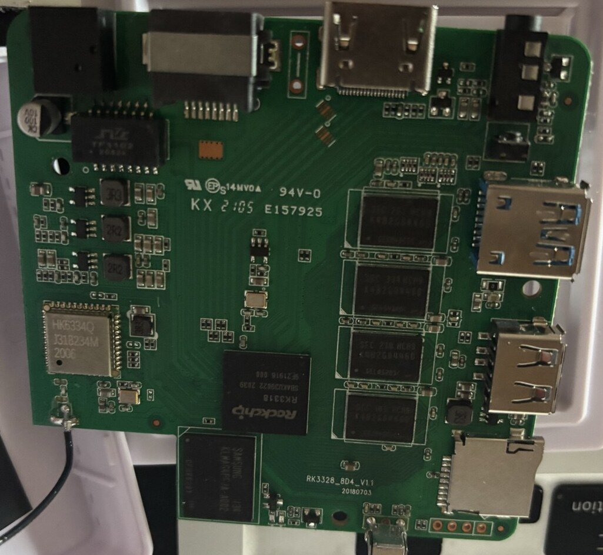
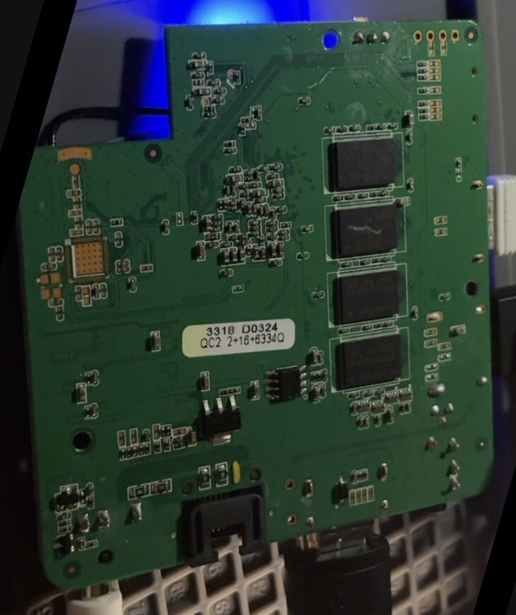
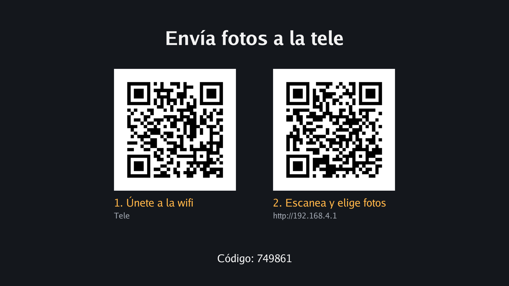
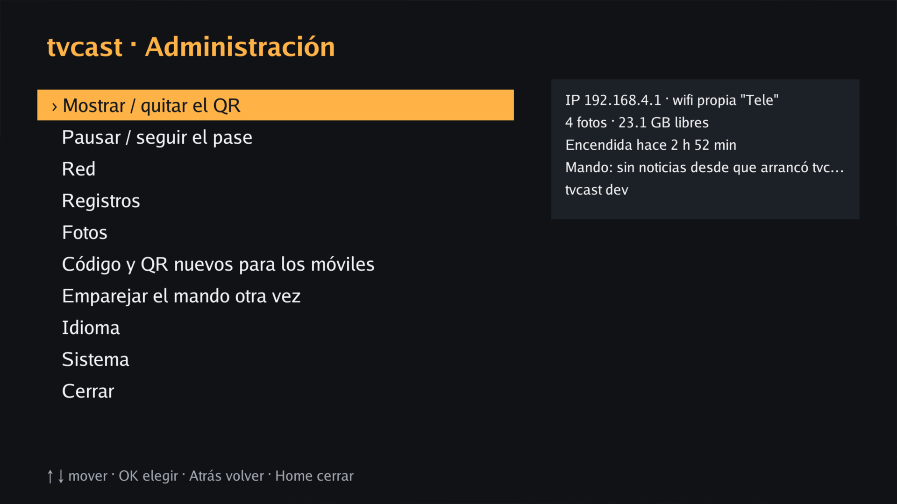

En una subasta me llevé por **4 €** una caja blanca que ponía *Sunday Box, photos & vidéos sur TV*. Pensé que sería algo tipo Chromecast. No lo es.

La **Sunday Box** es un producto de una startup francesa (Hopen Project SAS, marca Sunday) pensado para los abuelos: la conectas a la tele por HDMI, la familia manda fotos y vídeos desde una app del móvil y aparecen en la pantalla. Sin cuentas, sin menús, con un mando sencillo. La idea es bonita.

El problema: la enchufé, salió su app y se quedó eternamente intentando generar el **código de vinculación**. Sin ese código no hay nada que hacer con ella.

Así que me pasé una noche entera (de las 23:00 a pasadas las 4:00) intentando recuperar el control y montando encima mi propio sistema. A la mañana siguiente lo pulí: pantalla de arranque, algún detalle más y el mando. Con Claude de copiloto, una capturadora HDMI, un ESP32 y bastante cabezonería. **Casi todo lo que probé falló.** Este post va de eso, porque los fallos me enseñaron más que el acierto final.

> **Lo que sé y lo que supongo.** Voy a separar siempre las dos cosas. Por ejemplo: **no sé si Sunday ha cerrado el servicio**. No he encontrado ningún anuncio oficial. Lo que sí he comprobado es que el dominio de su API no existe en el DNS público (lo explico abajo). Que eso signifique "han cerrado" es una inferencia razonable, no un hecho confirmado.

## Qué hay dentro

Lo primero fue abrirla y mirar la placa. Lo que se lee en los chips y la serigrafía:

| Componente | Qué es |
|---|---|
| SoC | **Rockchip RK3318** (variante económica del RK3328; el recovery de Android se identifica como `rk3328`) |
| Placa | `RK3328_8D4_V1.1`, fechada en 2018 |
| Almacenamiento | eMMC Samsung `KLM4G1FE3C` |
| Configuración | Etiqueta "QC2 2+16": 2 GB de RAM y 16 GB de almacenamiento, según la etiqueta |
| Red | Solo WiFi (módulo Murata). **No tiene Ethernet** |
| Puertos | HDMI, 2× USB-A, microSD, jack de 3,5 mm, salida óptica S/PDIF y un botón escondido detrás del jack |
| Debug | **4 pads** junto al lector de microSD, uno marcado con una flecha |

Por dentro es una **TV box Android genérica** con un sistema de Sunday encima. El sistema es Android 9 (build `PQ2A`, "SundayBoxFamilies"). Esto es una buena noticia: el RK3318 tiene comunidad, y hay [Armbian para estas cajas](https://forum.armbian.com/topic/26978-csc-armbian-for-rk3318rk3328-tv-box-boards).



La cara superior: el SoC RK3318, la eMMC Samsung, el módulo WiFi `HK6334Q` (con su cable de antena negro) y, junto al lector de microSD, los 4 pads de depuración.



La cara inferior, con los chips de RAM y la etiqueta "QC2 2+16".

## ¿Está muerta la nube?

Antes de abrir nada quería descartar lo obvio: que el fallo fuera mío. En casa tengo AdGuard Home haciendo de DNS, y un bloqueador de DNS que se come un dominio puede dejar una app así, colgada.

El registro de consultas de AdGuard lo dejó claro. La caja pedía `backend-api-prod.aws.sunday.love`, AdGuard lo dejaba pasar (no estaba bloqueado), y la respuesta era **NXDOMAIN**: el dominio no existe. Lo único que bloqueaba AdGuard era `app-measurement.com`, que es telemetría de Firebase y no tiene nada que ver.

Para descartar mi red, lo comprobé contra un DNS público:

```bash
for d in backend-api-prod.aws.sunday.love api.sunday.love sunday.love; do
  printf "%-36s " "$d"
  dig @1.1.1.1 "$d" A +noall +comments | grep -o 'status: [A-Z]*'
done
```

```
backend-api-prod.aws.sunday.love     status: NXDOMAIN
api.sunday.love                      status: NXDOMAIN
sunday.love                          status: NOERROR
```

La web de la marca sigue resolviendo, pero **el backend al que llama la caja no existe en el DNS**, ni en mi red ni fuera. Eso es lo que comprobé la noche del 21 al 22 de noviembre de 2026. La conclusión práctica es que la caja no puede vincularse, se arregle lo que se arregle en mi red. La conclusión de negocio ("Sunday ha cerrado") la dejo como sospecha.

## Intento 1: Armbian desde la microSD

El plan inicial parecía sencillo: grabar la imagen de la comunidad para RK3318 (`Rk3318-box_trixie_current_6.18.64_minimal`) en una microSD y arrancar desde ahí, sin tocar la eMMC.

**Resultado: nada.** Con la SD puesta el LED se quedaba en rojo, sin imagen por HDMI y sin aparecer en la red. Sin la SD, LED azul y arrancaba el Android de siempre. La caja no cedía el arranque a la tarjeta.

Probé el botón escondido detrás del jack manteniéndolo pulsado al enchufar. Tampoco hizo nada visible.

## Intento 2: encontrar la caja en la red

Si iba a atacarla por red, primero tenía que encontrarla. La caja no anuncia nombre de host, así que tocó cruzar la lista de concesiones DHCP con varios `nmap -sn` mientras la encendía y apagaba. La pista buena fue que su MAC empieza por `00:37:6D`, que es un prefijo de **Murata**, el fabricante del módulo WiFi. El resto de desconocidos de la red tenían MAC aleatorias, típicas de móviles. Le fijé una IP en el DHCP y a por ella.

```bash
nmap -Pn -p- <ip-de-la-caja>
```

Todos los puertos que miré (22, 23, 80, 443, 5555…) salieron **filtered**: Android descarta los paquetes sin responder. Además el WiFi de la caja va en modo ahorro de energía: los primeros pings tardaban entre 5 y 7 segundos en contestar, lo que no ayuda nada a un escaneo. El escaneo completo de los 65.535 puertos estimaba casi dos horas, todo para confirmar que no había nada abierto. Lo maté.

## Intento 3: ADB, por todos los caminos posibles

Con ratón y teclado USB enchufados a la caja llegué a los ajustes de Android y a las **Opciones de desarrollador**. Ahí había dos interruptores:

- **USB debugging**, que se activaba sin problema.
- **Internet Adb**, un añadido del fabricante para ADB por WiFi. **No se activaba.** Ni con ratón, ni con teclado, ni después de un reset de fábrica.

Para ver la tele desde el Mac enchufé una **capturadora HDMI por USB** y la abrí en QuickTime. Así Claude podía ver la pantalla de la caja con capturas y guiarme clic a clic. Si vas a hacer algo parecido, te la recomiendo muchísimo.

Un detalle curioso: después de pulsar el interruptor roto, el puerto 5555 pasó de *filtered* a **Connection refused**. Algo cambió en el firewall, pero el demonio de ADB nunca llegó a escuchar por TCP. Probé también 4444 y 7777, por si acaso. Nada.

Quedaba ADB por cable. Los USB-A de estas cajas suelen ser solo *host* (para enchufarles cosas), pero a veces uno hace de OTG. Para salir de dudas usé un truco que me gustó: **contar los dispositivos USB que ve el Mac** con el cable puesto y quitado.

```bash
ioreg -p IOUSB -w 0 | grep -c "+-o"
```

13 con el cable y 13 sin él. La caja no aportaba nada. Lo repetí con un cable que sí sabía que transmitía datos (el iPhone me pidió "¿Confiar en este ordenador?"), en los dos puertos. Mismo resultado: **los dos USB-A son solo host**.

## Intento 4: DNS spoofing y MITM

Si el backend no existe, ¿y si me invento yo uno? El plan:

1. Una reescritura DNS en AdGuard: `backend-api-prod.aws.sunday.love` → mi Mac.
2. Un servidor "señuelo" en Python en los puertos 80 y 443, con un certificado autofirmado para `*.sunday.love`, que registrara todo lo que llegara.
3. Reiniciar la caja y ver qué pedía.

Ya sabía que TLS iba a ser un problema (si la app valida el certificado, no se iba a tragar el mío), pero aunque solo viera las peticiones ya aprendería algo.

**No llegó ni una petición.** Y el registro de AdGuard explicaba por qué: después del reinicio, la caja **no volvió a preguntar por el backend**. Solo NTP, el *connectivity check* de Google y métricas. Mi hipótesis es que la app cachea el fallo o tiene otra lógica de reintento, pero no lo he podido confirmar.

Siguiente idea: ver todo su tráfico con un MITM por ARP spoofing con **bettercap**. Tampoco. bettercap solo veía el tráfico del propio Mac y el multicast de la red, nada de la caja. Mi explicación más probable es que el punto de acceso aísla a los clientes WiFi entre sí, y el Mac iba por cable. Tampoco lo he verificado a fondo.

Vías de red: descartadas.

## Intento 5: sideload con un pendrive

Aquí llegó el primer éxito real. Revolviendo en los ajustes encontré la app oficial de Android para gestionar archivos, **Files**. Un gestor de archivos puede abrir APKs, y en Android 9 el permiso de "orígenes desconocidos" se da por app. Así que:

1. Pendrive en FAT32 con tres APKs: **FLauncher** (un launcher para Android TV), **TV Bro** (navegador) y **Termux** (terminal).
2. Pendrive a la caja, abrir cada APK desde el gestor, dar permiso al instalador e instalar.

**Las tres se instalaron.** La caja ya no era un kiosco cerrado.

Y entonces la rompí. Al abrir FLauncher para intentar que fuera el launcher por defecto, la caja se reinició y cayó en el **recovery de Android**:

```
Can't load Android system. Your data may be corrupt.
```

"Try again" la metía en un bucle: robot con error, pantalla negra, recovery otra vez. No sé exactamente qué lo provocó. Mi sospecha es un conflicto entre el launcher nuevo y el kiosco de Sunday, sumado a que **la eMMC defectuosa es un fallo muy común en estas cajas**, según la propia comunidad de Armbian. Lo que sí sé es lo que lo arregló: **un reset de fábrica**. Volvió al asistente de Sunday, sin mis apps, pero viva.

## Intento 6: modo maskrom

Los SoC de Rockchip tienen un modo **maskrom** en la ROM de arranque: el chip se presenta por USB como dispositivo (ID de fabricante `0x2207`) y con `rkdeveloptool` puedes leer y escribir la eMMC directamente. Es la puerta trasera oficial, y con ella podría hacer copia de la eMMC y flashear lo que quisiera.

`rkdeveloptool` no está en Homebrew, así que lo compilé. En macOS falla por un *array* de tamaño variable que Clang no acepta, y se arregla haciendo constante la variable:

```bash
git clone --depth 1 https://github.com/rockchip-linux/rkdeveloptool.git
cd rkdeveloptool
autoreconf -i
./configure
sed -i '' 's/int nSectorSize = 512;/const int nSectorSize = 512;/g' main.cpp
make
```

La herramienta funcionaba. La caja no apareció. Con el botón pulsado al dar corriente, en los dos puertos USB, varias veces: `not found any devices!`.

Luego leí en el foro de Armbian que en estas placas el maskrom se fuerza **puenteando el pin de reloj de la eMMC** al encender, no con un botón. Y además hace falta un puerto USB que funcione como dispositivo, y los USB-A no lo hacen. Puentear un pin de la eMMC con una foto movida de la placa me pareció la mejor forma de cargármela, así que no lo hice.

## Intento 7: la consola serie con un ESP32

Los **4 pads** junto a la microSD tienen toda la pinta de ser la UART de depuración (GND, TX, RX y VCC; la flecha marca el pin 1). Por ahí sale el log del bootloader y puedes interrumpir u-boot. No tenía un adaptador USB-TTL de 3,3 V, pero sí un **ESP32**, que trabaja a la misma tensión que la caja, y preparé con él un puente USB-serie (la UART de Rockchip va a 1.500.000 baudios). El plan estaba listo, pero **no tenía cables Dupont**, el tester no tenía pilas y eran más de las dos de la madrugada. Se quedó documentado para otro día.

## Intento 8: el Multitool

Antes de rendirme me acordé del **Armbian Multitool**: una imagen pequeña de mantenimiento para estas cajas que sirve para hacer copia de la eMMC, restaurarla o flashear otra imagen, todo desde la SD. El enlace oficial estaba caído (hay quejas en el foro desde noviembre de 2025), pero encontré un mirror en GitHub. Comprobé que el `.xz` era íntegro y lo grabé:

```bash
xz -t multitool.img.xz
xz -dc multitool.img.xz | sudo dd of=/dev/rdiskN bs=1m
```

> Ojo con el `dd`: comprueba con `diskutil list` qué disco es la SD **antes** de escribir. Equivocarte de número borra otro disco sin preguntar.

> **Ojo con el mirror.** El enlace oficial de jock (`users.armbian.com/jock/rk3318/multitool.img.xz`) ya no responde. Yo usé un [mirror de terceros en GitHub](https://github.com/sholehbaktiabadi/rockchip-rk3318-armbian-os/releases/tag/0.0.4) (`multitool.img.xz`), **no oficial**. Su SHA-256 es `9ce854059656f32c70ccb2d661c6c25ee0577bad5c507ddcfa587b2e1659449a`; compruébalo antes de grabarlo y, si puedes, compáralo con una fuente oficial, que yo no he encontrado. El proyecto sigue en el [hilo de Armbian para RK3318/RK3328](https://forum.armbian.com/topic/26978-csc-armbian-for-rk3318rk3328-tv-box-boards).

## Cómo acabó: Armbian en la eMMC

Y esta vez sí. Donde la imagen de Armbian se había quedado en un LED rojo, **el Multitool arrancó desde la SD**. Fue lo que desbloqueó todo:

1. **Primero, copia de la eMMC.** Lo que debería haber sido el paso uno de la noche acabó siendo el último, pero lo hice antes de tocar nada. Si algún día quiero volver al Android de Sunday (no sé para qué), puedo.
2. **Después, grabar Armbian en la eMMC** desde el propio Multitool. La imagen fue la misma que no arrancaba desde la SD: [`Armbian_community_26.11.0-trunk.137_Rk3318-box_trixie_current_6.18.64_minimal`](https://github.com/armbian/community/releases/tag/26.11.0-trunk.137) (SHA-256 `e275c6016008a60370b12a2e3efdb36530c81656fd5775de755ebbd8611e254a`). Ya no depende de la SD.
3. **Arrancar.** Armbian arrancó desde la eMMC.


Lo que corre ahora mismo:

| | |
|---|---|
| Sistema | Armbian (Debian trixie), kernel 6.18 `rockchip64` |
| Disco | En la eMMC (`mmcblk2`), unos 15 GB útiles |
| RAM | 1,9 GB visibles |
| WiFi | Módulo Murata con chip **Broadcom BCM4334** por SDIO, driver `brcmfmac`, firmware 6.10.191 de 2019 |

La caja que llegó como un pisapapeles con un asistente que no terminaba nunca ahora arranca **Armbian desde su propia eMMC**, y es mía.

## Después: tvcast, mi propia Sunday Box

Con Linux en la caja, el siguiente paso era devolverle su propósito original sin depender de la nube de nadie. Lo he llamado **tvcast**, y tiene una restricción que lo condiciona todo: **la caja va a una casa sin WiFi**. Así que no puede depender de ninguna red; tiene que **crear la suya**, que se llama `Tele`.

El código es libre, con licencia AGPL-3.0: **[github.com/usarral/tvcast](https://github.com/usarral/tvcast)**. Incluye la guía de instalación en inglés y español y las lecciones aprendidas en el hardware real.

La idea:

- La tele muestra un **código QR**. Lo escaneas con el móvil, te conectas a la WiFi de la caja y se abre una web para **subir fotos**.
- Las fotos salen en la tele como pase de diapositivas.


Por dentro es sencillo: un **binario de Go estático para arm64**, que corre como usuario de sistema bajo **systemd** y escucha en el puerto 80 gracias a `CAP_NET_BIND_SERVICE` (sin ser root). Las fotos las pinta **mpv directamente por DRM/KMS** a 1920×1080, sin X ni gestor de ventanas. La primera prueba, todavía por la WiFi de casa, recibió fotos a la primera.

### El hallazgo: WPA2 que nunca arranca

Montar el punto de acceso me costó bastante más que el resto. `iw list` decía que el chip soportaba modo AP, así que lo intenté con lo que traía el sistema.

Primero, una sorpresa: Armbian gestionaba el WiFi con **netplan + systemd-networkd**, y NetworkManager lo veía como `unmanaged` por una regla de udev de netplan. Lo pasé a NetworkManager. Después, el punto de acceso de NetworkManager **falló tres veces seguidas**:

1. **`key setting validation failed`** en el log del kernel. Se arregló desactivando PMF (*Protected Management Frames*).
2. **Faltaba `dnsmasq-base`**, que NetworkManager necesita para dar IPs en modo compartido.
3. Y la buena: la red `Tele` aparecía, pero el móvil decía **"contraseña incorrecta"**. Con `iw event` se veía que el móvil **sí se asociaba** (`new station`… `del station`), pero el `wpa_supplicant` que NetworkManager usa en modo AP **nunca empezaba el 4-way handshake** de WPA2 con este Broadcom. Con una **red abierta** sí funcionaba, lo que dejaba el problema aislado en el WPA2 del AP de NetworkManager.

La solución fue sacar a NetworkManager del punto de acceso y montarlo a la antigua, con **hostapd + dnsmasq** en servicios propios (`tele-ap` y `tele-dhcp`). Así el **4-way handshake se completa**: lo comprobé con un iPhone. NetworkManager sigue llevando la WiFi de casa.

Por qué falla exactamente NetworkManager + `brcmfmac` + este firmware no lo sé. Puede tener que ver con el firmware viejo (además, sin `clm_blob`), pero es una sospecha, no algo comprobado.

### Las trampas de una caja que solo tiene WiFi

- **Si cambias la red por SSH, te quedas fuera.** No hay Ethernet, así que tocar el WiFi corta tu propia sesión. Antes de cada cambio programé una **vuelta atrás automática** con `systemd-run --on-active=10m`: si no la cancelo, la red vuelve sola a como estaba.
- **Arrancar sin la WiFi de casa.** Un servicio `tele-auto` espera 40 segundos; si no encuentra la red de casa, levanta `Tele`. Y tvcast se reinicia cada vez que `Tele` sube o baja, para que el QR lleve la IP correcta.
- **Atajos de teclado como salida de emergencia**, con un teclado USB enchufado a la caja (los de Q, S, V y T van con `triggerhappy`):

| Atajo | Qué hace |
|---|---|
| Ctrl+Alt+C | Abre una consola |
| Ctrl+Alt+T | Muestra el QR |
| Ctrl+Alt+Q | Deja el QR fijo en pantalla |
| Ctrl+Alt+S | Pase de diapositivas |
| Ctrl+Alt+V | Vacía las fotos |

- **mpv no suelta la pantalla.** Mientras mpv tiene el *DRM master*, Ctrl+Alt+F2 no te lleva a ninguna consola. Por eso existe el atajo Ctrl+Alt+C. Ya en consola hay comandos cortos para lo habitual: `ayuda`, `casa`, `tele`, `logwifi`, `qr`, `vaciar`…

### UX: dónde poner el QR

Primera versión: el QR salía mientras no hubiera fotos. En cuanto subías unas cuantas, **desaparecía**, y quien llegara después no tenía forma de conectarse. Ahora, durante el pase de fotos hay un **QR pequeño en una esquina con un PIN de 6 cifras**, y **cada 12 fotos aparece el QR completo**.



### La tele enseñaba la consola al arrancar

En cada arranque en frío, la tele enseñaba la consola unos segundos antes de las fotos. No era la red: tvcast esperaba solo 5 s a que mpv creara su socket IPC y, con la CPU a tope al arrancar, mpv tarda unos 8 s en abrir DRM. tvcast lo daba por muerto, lo mataba (y salía la consola) y lo relanzaba 2 s después. El journal lo delata con `mpv: no IPC socket` nada más arrancar. Ahora espera hasta 30 s mientras el proceso de mpv siga vivo.

Para esconder el resto descarté Plymouth: va en el initramfs y, al salir, deja un hueco (negro o el login) hasta que mpv pinta. En su lugar, `console=serial` en `armbianEnv.txt`, `vt.global_cursor_default=0 logo.nologo` y una imagen pintada directamente en `/dev/fb0` en cuanto arranca systemd. Lo que hace u-boot en los primeros segundos no se puede esconder sin recompilarlo.

La primera versión era una imagen cruda fija de 2560×1440 en BGRX, justo el modo preferido de mi tele (el framebuffer de la consola no va a la resolución de mpv, sino al modo que elija la pantalla). En cuanto enchufé la caja a **otro monitor** (un portátil Arzopa, con un framebuffer de 1920×1080) la imagen no cabía: `cat` fallaba con `ENOSPC` y la pantalla de arranque salía rota. Ahora un pequeño `tvcast-splash` lee por `ioctl` la resolución, los bits por píxel, el orden de los colores y el *stride* del framebuffer, y pinta la imagen adaptada en cada arranque. La lección: nunca supongas que el framebuffer será el de tu tele.

### Un panel de administración oculto

Los atajos sueltos de la tabla de arriba empezaban a ser demasiados, así que los sustituye un **panel de administración oculto**. Se abre con Ctrl+Alt+A (y, cuando el mando funcione, con una combinación de botones). Enseña el estado de la caja, el QR, la red y los logs, y deja borrar fotos, volver a emparejar el mando, cambiar el idioma, reiniciar o abrir la consola. Cada acción destructiva pide confirmación (No/Sí), y las que necesitan root van por systemd y polkit, sin `sudo`.



### Lo que queda: el mando

Todavía me falta que el **mando original** de la Sunday Box funcione bien en la caja. No es infrarrojo sino Bluetooth LE, y es lo que más problemas me está dando, sobre todo con el Bluetooth interno de la caja, que de momento no es de fiar. Lo dejo para un próximo post, cuando lo tenga resuelto.

## Lo que no salió bien

Aunque el final sea feliz, la mayor parte de la noche fue esto:

- **La SD no arrancaba y no supe por qué.** Sin consola serie solo tenía un LED rojo como pista.
- **El interruptor de ADB por red está roto de fábrica.** Lo probé de todas las formas posibles.
- **Me cargué el Android** al instalar un launcher, y solo lo salvó un reset de fábrica. Si la eMMC hubiera estado peor, ahí se acababa todo.
- **El maskrom por botón no existe en esta placa**, y el bueno exige puentear un pin que no me atreví a tocar.
- **Me faltó lo más tonto:** cuatro cables Dupont y pilas para el tester.
- **El copiloto también se equivocó**, y conviene contarlo. Claude dio por hecho que la caja tenía Ethernet (el conector pequeño era la salida óptica), me mandó a buscar un botón de reset dentro del jack AV que no existe (el botón está en otro sitio), interpretó un menú de ajustes como prueba de que había OTG cuando no la era, y confundió un conector de la placa con un micro-USB. Para encontrar la caja en la red apostó por su MAC a partir del prefijo de Murata; acabó siendo correcta, pero durante un rato fue solo una hipótesis que un ping fallido puso en duda, y así me lo dijo. Lo bueno es que cada error se corrigió en cuanto le enseñé una foto o un dato, y que en general marcaba bien qué era una comprobación y qué una suposición. Lo útil de verdad fue esa disciplina: medir antes de afirmar (los 13 nodos USB, el `dig` contra 1.1.1.1, el registro de AdGuard).
- **Di por hecho que el AP de NetworkManager valdría con `brcmfmac`.** Tres intentos hasta aceptar que no y pasar a hostapd.
- **La primera prueba de reinicio pareció fallar.** En realidad `Tele` tardaba unos 65 segundos en aparecer y no esperé lo suficiente.
- **La copia de la eMMC llegó tardísimo.** Era lo primero de la lista y no pude hacerla hasta el final, cuando arrancó el Multitool. Mientras tanto hice un reset de fábrica y metí APKs que rompieron el arranque, todo sin red de seguridad.

## Lo que me llevo

- **Comprueba antes de suponer.** "Los servidores están caídos" pasó a ser "el dominio no existe en el DNS público" con un `dig`. Sigue sin ser "la empresa ha cerrado", y está bien decirlo así.
- **Una capturadora HDMI USB** convierte cualquier aparato con pantalla en algo que puedes depurar desde el ordenador.
- **Contar dispositivos USB** con el cable puesto y quitado es una forma tonta y fiable de saber si un puerto hace algo.
- **Un ESP32 sirve de puente USB-serie** si no tienes un USB-TTL a mano, y además trabaja a 3,3 V (aunque yo no llegué a probarlo).
- **En estas cajas, prueba el Multitool antes que nada.** Una imagen genérica de Armbian puede no arrancar desde la SD y el Multitool sí. Me habría ahorrado media noche, y me habría dado la copia de la eMMC desde el principio.
- **Cuando cambies la red de una caja que solo tiene WiFi, programa antes la vuelta atrás.**
- **No supongas el framebuffer de tu tele.** Lee la resolución, el orden de colores y el *stride* al arrancar.
- **Sin pila de reloj, no te fíes de la hora de los logs.** Para ordenar un arranque, `journalctl -o short-monotonic`.
- **Ten la UART como plan B.** Todo lo demás (ADB, DNS, MITM, botones) dependía de que el fabricante me lo pusiera fácil, y no lo hizo. El puente con el ESP32 queda listo para cuando haga falta.
