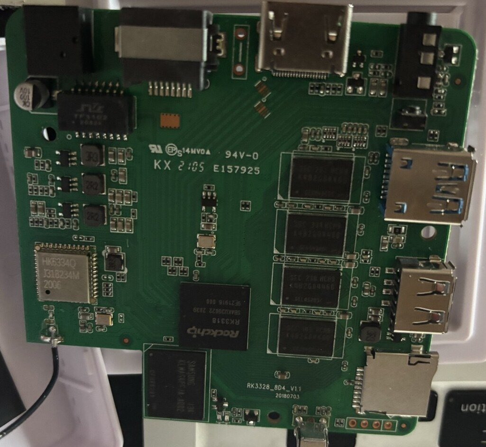
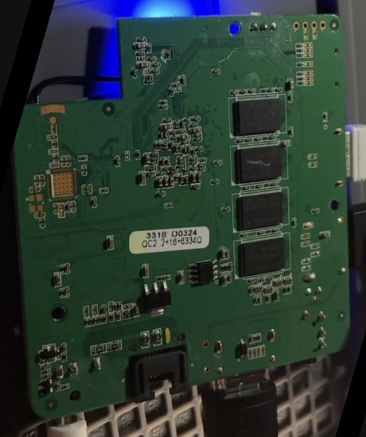
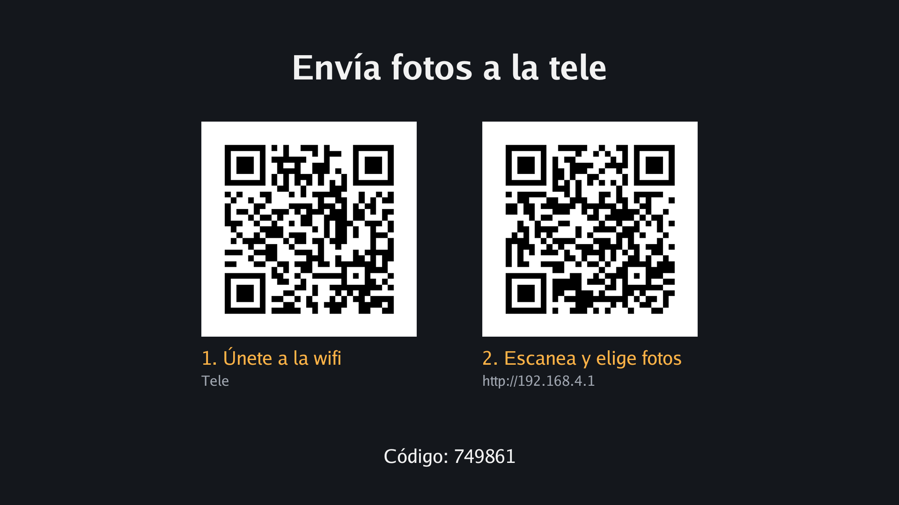
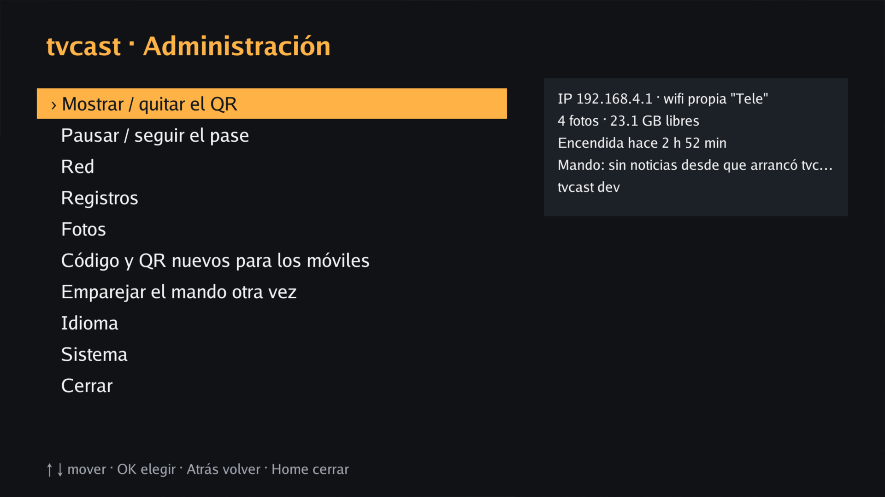

At an auction I walked away with a white box for **€4** that said *Sunday Box, photos & vidéos sur TV*. I figured it would be something like a Chromecast. It isn't.

The **Sunday Box** is a product from a French startup (Hopen Project SAS, brand name Sunday) designed for grandparents: you plug it into the TV over HDMI, the family sends photos and videos from a phone app, and they show up on the screen. No accounts, no menus, a simple remote. A lovely idea.

The problem: I plugged it in, its app came up and then sat there forever trying to generate the **pairing code**. Without that code, there's nothing you can do with it.

So I spent an entire night (from 11 pm to well past 4 am) trying to take control back and building my own system on top of it. The next morning I polished it: boot screen, a few more details and the remote. With Claude as copilot, an HDMI capture card, an ESP32 and a lot of stubbornness. **Almost everything I tried failed.** This post is about that, because the failures taught me more than the final success did.

> **What I know and what I'm guessing.** I'll keep the two apart throughout. For example: **I don't know whether Sunday has shut the service down**. I haven't found any official announcement. What I did verify is that the domain of their API doesn't exist in public DNS (more on that below). Whether that means "they've closed" is a reasonable inference, not a confirmed fact.

## What's inside

First I opened it up and looked at the board. This is what you can read on the chips and the silkscreen:

| Component | What it is |
|---|---|
| SoC | **Rockchip RK3318** (a budget variant of the RK3328; the Android recovery identifies it as `rk3328`) |
| Board | `RK3328_8D4_V1.1`, dated 2018 |
| Storage | Samsung eMMC `KLM4G1FE3C` |
| Configuration | "QC2 2+16" label: 2 GB of RAM and 16 GB of storage, according to the label |
| Network | WiFi only (Murata module). **No Ethernet** |
| Ports | HDMI, 2× USB-A, microSD, 3.5 mm jack, optical S/PDIF output and a button hidden behind the jack |
| Debug | **4 pads** next to the microSD reader, one marked with an arrow |

Inside, it's a **generic Android TV box** with a Sunday system on top. The OS is Android 9 (build `PQ2A`, "SundayBoxFamilies"). That's good news: the RK3318 has a community, and there's [Armbian for these boxes](https://forum.armbian.com/topic/26978-csc-armbian-for-rk3318rk3328-tv-box-boards).



The top side: the RK3318 SoC, the Samsung eMMC, the `HK6334Q` WiFi module (with its black antenna cable) and, next to the microSD reader, the 4 debug pads.



The bottom side, with the RAM chips and the "QC2 2+16" label.

## Is the cloud dead?

Before opening anything else I wanted to rule out the obvious: that the fault was mine. At home I run AdGuard Home as my DNS, and a DNS blocker that swallows the wrong domain can leave an app like this hanging.

AdGuard's query log settled it. The box was asking for `backend-api-prod.aws.sunday.love`, AdGuard let it through (it wasn't blocked), and the answer was **NXDOMAIN**: the domain doesn't exist. The only thing AdGuard was blocking was `app-measurement.com`, which is Firebase telemetry and has nothing to do with this.

To rule out my own network, I checked against a public DNS server:

```bash
for d in backend-api-prod.aws.sunday.love api.sunday.love sunday.love; do
  printf "%-36s " "$d"
  dig @1.1.1.1 "$d" A +noall +comments | grep -o 'status: [A-Z]*'
done
```

```
backend-api-prod.aws.sunday.love     status: NXDOMAIN
api.sunday.love                      status: NXDOMAIN
sunday.love                          status: NOERROR
```

The brand's website still resolves, but **the backend the box talks to doesn't exist in DNS**, neither on my network nor outside it. That's what I verified on the night of 21 to 22 November 2026. The practical conclusion is that the box can't be paired, no matter what I fix on my network. The business conclusion ("Sunday has shut down") I'll leave as a suspicion.

## Attempt 1: Armbian from the microSD

The initial plan looked simple: write the community image for RK3318 (`Rk3318-box_trixie_current_6.18.64_minimal`) to a microSD and boot from it, without touching the eMMC.

**Result: nothing.** With the SD inserted, the LED stayed red, no picture over HDMI and no sign of it on the network. Without the SD, blue LED and the usual Android booted. The box wouldn't hand the boot over to the card.

I tried the hidden button behind the jack, holding it while plugging in the power. That didn't visibly do anything either.

## Attempt 2: finding the box on the network

If I was going to attack it over the network, I first had to find it. The box doesn't announce a hostname, so I had to cross-reference the DHCP lease list with several `nmap -sn` scans while switching it on and off. The good lead was that its MAC starts with `00:37:6D`, a **Murata** prefix, the maker of the WiFi module. The other unknown devices on my network had random MACs, typical of phones. I pinned it an IP in the DHCP server and went after it.

```bash
nmap -Pn -p- <box-ip>
```

Every port I looked at (22, 23, 80, 443, 5555…) came back **filtered**: Android drops the packets without replying. On top of that, the box's WiFi runs in power-saving mode: the first pings took 5 to 7 seconds to answer, which doesn't help a scan at all. The full scan of all 65,535 ports estimated almost two hours, all to confirm that nothing was open. I killed it.

## Attempt 3: ADB, by every possible route

With a USB mouse and keyboard plugged into the box I got into the Android settings and the **Developer options**. There were two switches there:

- **USB debugging**, which turned on without any trouble.
- **Internet Adb**, a vendor addition for ADB over WiFi. **It wouldn't turn on.** Not with the mouse, not with the keyboard, not after a factory reset.

To see the TV from the Mac I plugged in a **USB HDMI capture card** and opened it in QuickTime. That way Claude could see the box's screen through screenshots and guide me click by click. If you're going to do something similar, I can't recommend it enough.

A curious detail: after pressing the broken switch, port 5555 went from *filtered* to **Connection refused**. Something changed in the firewall, but the ADB daemon never actually listened over TCP. I also tried 4444 and 7777, just in case. Nothing.

That left ADB over a cable. The USB-A ports on these boxes are usually *host* only (for plugging things into them), but sometimes one doubles as OTG. To settle it I used a trick I liked: **counting the USB devices the Mac sees** with the cable plugged and unplugged.

```bash
ioreg -p IOUSB -w 0 | grep -c "+-o"
```

13 with the cable, 13 without. The box contributed nothing. I repeated it with a cable I knew carried data (my iPhone asked "Trust this computer?"), on both ports. Same result: **both USB-A ports are host only**.

## Attempt 4: DNS spoofing and MITM

If the backend doesn't exist, what if I invent one? The plan:

1. A DNS rewrite in AdGuard: `backend-api-prod.aws.sunday.love` → my Mac.
2. A decoy Python server on ports 80 and 443, with a self-signed certificate for `*.sunday.love`, logging everything that came in.
3. Reboot the box and see what it asked for.

I already knew TLS was going to be a problem (if the app validates the certificate, it wasn't going to swallow mine), but even just seeing the requests would teach me something.

**Not a single request arrived.** And AdGuard's log explained why: after the reboot, the box **never asked for the backend again**. Only NTP, Google's *connectivity check* and metrics. My hypothesis is that the app caches the failure or has some other retry logic, but I haven't been able to confirm it.

Next idea: watch all its traffic with an ARP-spoofing MITM using **bettercap**. That didn't work either. bettercap only saw the Mac's own traffic and the network's multicast, nothing from the box. My most likely explanation is that the access point isolates WiFi clients from each other, and the Mac was on a cable. I haven't checked that thoroughly either.

Network routes: ruled out.

## Attempt 5: sideloading with a USB stick

This is where the first real success came. Poking around in the settings I found Android's official file manager app, **Files**. A file manager can open APKs, and on Android 9 the "unknown sources" permission is granted per app. So:

1. A FAT32 USB stick with three APKs: **FLauncher** (a launcher for Android TV), **TV Bro** (a browser) and **Termux** (a terminal).
2. Stick into the box, open each APK from the file manager, grant the installer permission and install.

**All three installed.** The box was no longer a locked-down kiosk.

And then I broke it. When I opened FLauncher to try to make it the default launcher, the box rebooted and dropped into **Android recovery**:

```
Can't load Android system. Your data may be corrupt.
```

"Try again" put it in a loop: robot with an error, black screen, recovery again. I don't know exactly what caused it. My suspicion is a conflict between the new launcher and Sunday's kiosk, plus the fact that **a faulty eMMC is a very common failure on these boxes**, according to the Armbian community itself. What I do know is what fixed it: **a factory reset**. It came back to the Sunday wizard, without my apps, but alive.

## Attempt 6: maskrom mode

Rockchip SoCs have a **maskrom** mode in the boot ROM: the chip shows up over USB as a device (vendor ID `0x2207`) and with `rkdeveloptool` you can read and write the eMMC directly. It's the official back door, and with it I could back up the eMMC and flash whatever I wanted.

`rkdeveloptool` isn't in Homebrew, so I compiled it. On macOS it fails because of a variable-length *array* that Clang doesn't accept, and the fix is to make the variable constant:

```bash
git clone --depth 1 https://github.com/rockchip-linux/rkdeveloptool.git
cd rkdeveloptool
autoreconf -i
./configure
sed -i '' 's/int nSectorSize = 512;/const int nSectorSize = 512;/g' main.cpp
make
```

The tool worked. The box didn't show up. With the button held while powering on, on both USB ports, several times: `not found any devices!`.

Then I read on the Armbian forum that on these boards maskrom is forced by **shorting the eMMC clock pin** at power-on, not with a button. And you also need a USB port that works as a device, which the USB-A ports don't. Shorting an eMMC pin guided by a blurry photo of the board seemed like the best way to kill it, so I didn't.

## Attempt 7: the serial console with an ESP32

The **4 pads** next to the microSD look very much like the debug UART (GND, TX, RX and VCC; the arrow marks pin 1). That's where the bootloader log comes out and where you can interrupt u-boot. I didn't have a 3.3 V USB-TTL adapter, but I did have an **ESP32**, which runs at the same voltage as the box, and I set up a USB-serial bridge with it (the Rockchip UART runs at 1,500,000 baud). The plan was ready, but **I had no Dupont cables**, the multimeter had no batteries and it was past two in the morning. It stayed documented for another day.

## Attempt 8: the Multitool

Before giving up I remembered the **Armbian Multitool**: a small maintenance image for these boxes that lets you back up the eMMC, restore it or flash another image, all from the SD. The official link was down (there have been complaints on the forum since November 2025), but I found a mirror on GitHub. I checked that the `.xz` was intact and wrote it out:

```bash
xz -t multitool.img.xz
xz -dc multitool.img.xz | sudo dd of=/dev/rdiskN bs=1m
```

> Careful with `dd`: check with `diskutil list` which disk is the SD **before** writing. Getting the number wrong wipes another disk without asking.

> **Careful with the mirror.** The official link from jock (`users.armbian.com/jock/rk3318/multitool.img.xz`) no longer responds. I used a [third-party mirror on GitHub](https://github.com/sholehbaktiabadi/rockchip-rk3318-armbian-os/releases/tag/0.0.4) (`multitool.img.xz`), which is **unofficial**. Its SHA-256 is `9ce854059656f32c70ccb2d661c6c25ee0577bad5c507ddcfa587b2e1659449a`; check it before writing it and, if you can, compare it against an official source, which I haven't found. The project lives on in the [Armbian thread for RK3318/RK3328](https://forum.armbian.com/topic/26978-csc-armbian-for-rk3318rk3328-tv-box-boards).

## How it ended: Armbian on the eMMC

And this time it worked. Where the Armbian image had stalled on a red LED, **the Multitool booted from the SD**. That unlocked everything:

1. **First, a backup of the eMMC.** What should have been step one of the night ended up being the last, but I did it before touching anything. If I ever want to go back to Sunday's Android (no idea why), I can.
2. **Then, writing Armbian to the eMMC** from the Multitool itself. The image was the same one that wouldn't boot from the SD: [`Armbian_community_26.11.0-trunk.137_Rk3318-box_trixie_current_6.18.64_minimal`](https://github.com/armbian/community/releases/tag/26.11.0-trunk.137) (SHA-256 `e275c6016008a60370b12a2e3efdb36530c81656fd5775de755ebbd8611e254a`). It no longer depends on the SD.
3. **Boot.** Armbian booted from the eMMC.


What's running right now:

| | |
|---|---|
| System | Armbian (Debian trixie), `rockchip64` kernel 6.18 |
| Disk | On the eMMC (`mmcblk2`), about 15 GB usable |
| RAM | 1.9 GB visible |
| WiFi | Murata module with a **Broadcom BCM4334** chip over SDIO, `brcmfmac` driver, firmware 6.10.191 from 2019 |

The box that arrived as a paperweight with a wizard that never finished now boots **Armbian from its own eMMC**, and it's mine.

## Afterwards: tvcast, my own Sunday Box

With Linux on the box, the next step was giving it back its original purpose without depending on anyone's cloud. I called it **tvcast**, and it has one constraint that shapes everything: **the box is going to a house with no WiFi**. So it can't depend on any network; it has to **create its own**, called `Tele`.

The code is free software, under AGPL-3.0: **[github.com/usarral/tvcast](https://github.com/usarral/tvcast)**. It includes the installation guide in English and Spanish and the lessons learned on the real hardware.

The idea:

- The TV shows a **QR code**. You scan it with your phone, join the box's WiFi and a web page opens where you can **upload photos**.
- The photos appear on the TV as a slideshow.


Inside it's simple: a **static Go binary for arm64**, running as a system user under **systemd** and listening on port 80 thanks to `CAP_NET_BIND_SERVICE` (without being root). The photos are drawn by **mpv straight over DRM/KMS** at 1920×1080, with no X and no window manager. The first test, still over my home WiFi, received photos on the first try.

### The finding: WPA2 that never starts

Setting up the access point cost me quite a bit more than everything else. `iw list` said the chip supported AP mode, so I tried it with what the system shipped.

First, a surprise: Armbian managed WiFi with **netplan + systemd-networkd**, and NetworkManager saw it as `unmanaged` because of a netplan udev rule. I moved it over to NetworkManager. After that, NetworkManager's access point **failed three times in a row**:

1. **`key setting validation failed`** in the kernel log. Fixed by disabling PMF (*Protected Management Frames*).
2. **`dnsmasq-base` was missing**, which NetworkManager needs to hand out IPs in shared mode.
3. And the good one: the `Tele` network showed up, but the phone said **"wrong password"**. With `iw event` you could see the phone **did associate** (`new station`… `del station`), but the `wpa_supplicant` that NetworkManager uses in AP mode **never started the WPA2 4-way handshake** with this Broadcom. With an **open network** it did work, which isolated the problem to the WPA2 of NetworkManager's AP.

The fix was to take NetworkManager out of the access point and build it the old-fashioned way, with **hostapd + dnsmasq** as their own services (`tele-ap` and `tele-dhcp`). That way the **4-way handshake completes**: I checked it with an iPhone. NetworkManager still handles the home WiFi.

Why exactly NetworkManager + `brcmfmac` + this firmware fails, I don't know. It might have to do with the old firmware (which also has no `clm_blob`), but that's a suspicion, not something I've verified.

### The traps of a box that only has WiFi

- **If you change the network over SSH, you lock yourself out.** There's no Ethernet, so touching the WiFi cuts your own session. Before every change I scheduled an **automatic rollback** with `systemd-run --on-active=10m`: if I don't cancel it, the network goes back to how it was on its own.
- **Booting without the home WiFi.** A `tele-auto` service waits 40 seconds; if it doesn't find the home network, it brings up `Tele`. And tvcast restarts every time `Tele` goes up or down, so the QR carries the right IP.
- **Keyboard shortcuts as an emergency exit**, with a USB keyboard plugged into the box (the Q, S, V and T ones are handled by `triggerhappy`):

| Shortcut | What it does |
|---|---|
| Ctrl+Alt+C | Opens a console |
| Ctrl+Alt+T | Shows the QR |
| Ctrl+Alt+Q | Pins the QR on screen |
| Ctrl+Alt+S | Slideshow |
| Ctrl+Alt+V | Clears the photos |

- **mpv won't let go of the screen.** While mpv holds the *DRM master*, Ctrl+Alt+F2 doesn't take you to any console. That's why the Ctrl+Alt+C shortcut exists. Once in the console there are short commands for the usual things: `ayuda`, `casa`, `tele`, `logwifi`, `qr`, `vaciar`…

### UX: where to put the QR

First version: the QR showed up while there were no photos. As soon as you uploaded a few, it **disappeared**, and anyone arriving afterwards had no way to connect. Now, during the slideshow there's a **small QR in a corner with a 6-digit PIN**, and **every 12 photos the full QR appears**.



### The TV showed the console at boot

On every cold boot, the TV showed the console for a few seconds before the photos. It wasn't the network: tvcast waited only 5 s for mpv to create its IPC socket and, with the CPU maxed out at startup, mpv takes about 8 s to open DRM. tvcast assumed it was dead, killed it (and the console appeared) and relaunched it 2 s later. The journal gives it away with `mpv: no IPC socket` right at startup. Now it waits up to 30 s as long as the mpv process is still alive.

To hide the rest I ruled out Plymouth: it lives in the initramfs and, when it exits, leaves a gap (black or the login) until mpv draws. Instead I used `console=serial` in `armbianEnv.txt`, `vt.global_cursor_default=0 logo.nologo` and an image painted straight into `/dev/fb0` as soon as systemd starts. What u-boot does in the first few seconds can't be hidden without recompiling it.

The first version was a fixed raw image of 2560×1440 in BGRX, exactly my TV's preferred mode (the console framebuffer doesn't run at mpv's resolution, but at whatever mode the display picks). As soon as I plugged the box into **another monitor** (an Arzopa laptop display, with a 1920×1080 framebuffer) the image didn't fit: `cat` failed with `ENOSPC` and the boot screen came out broken. Now a small `tvcast-splash` reads the framebuffer's resolution, bits per pixel, colour order and *stride* through an `ioctl`, and paints the adapted image on every boot. The lesson: never assume the framebuffer will be your TV's.

### A hidden admin panel

The loose shortcuts in the table above were getting to be too many, so they're replaced by a **hidden admin panel**. It opens with Ctrl+Alt+A (and, once the remote works, with a combination of buttons). It shows the box's status, the QR, the network and the logs, and lets you delete photos, re-pair the remote, change the language, reboot or open the console. Every destructive action asks for confirmation (No/Yes), and the ones that need root go through systemd and polkit, without `sudo`.



### What's left: the remote

I still need the Sunday Box's **original remote** to work properly with the box. It isn't infrared but Bluetooth LE, and it's what's giving me the most trouble, especially with the box's internal Bluetooth, which for now can't be trusted. I'll leave it for a future post, once I've got it sorted.

## What didn't go well

Even if the ending is a happy one, most of the night was this:

- **The SD wouldn't boot and I never found out why.** Without a serial console, a red LED was all I had to go on.
- **The network ADB switch is broken from the factory.** I tried it every way I could.
- **I bricked the Android** by installing a launcher, and only a factory reset saved it. If the eMMC had been in worse shape, that would have been the end.
- **There's no maskrom button on this board**, and the real one requires shorting a pin I didn't dare touch.
- **I was missing the dumbest things:** four Dupont cables and batteries for the multimeter.
- **The copilot got things wrong too**, and it's worth saying so. Claude took it for granted that the box had Ethernet (the small connector was the optical output), sent me looking for a reset button inside the AV jack that doesn't exist (the button is somewhere else), read a settings menu as proof that there was OTG when it wasn't, and mistook a connector on the board for a micro-USB. To find the box on the network it bet on its MAC from the Murata prefix; it turned out to be right, but for a while it was just a hypothesis that a failed ping cast doubt on, and it told me so. The good part is that every mistake got corrected as soon as I showed it a photo or a piece of data, and that it generally flagged what was a check and what was a guess. What was really useful was that discipline: measure before asserting (the 13 USB nodes, the `dig` against 1.1.1.1, the AdGuard log).
- **I assumed NetworkManager's AP would be fine with `brcmfmac`.** Three attempts before accepting it wouldn't and switching to hostapd.
- **The first reboot test looked like a failure.** In reality `Tele` took about 65 seconds to appear and I didn't wait long enough.
- **The eMMC backup came very late.** It was first on the list and I couldn't do it until the end, when the Multitool booted. In the meantime I did a factory reset and loaded APKs that broke the boot, all without a safety net.

## What I take away from this

- **Check before assuming.** "The servers are down" became "the domain doesn't exist in public DNS" with a single `dig`. It still isn't "the company has closed", and it's fine to say it that way.
- **A USB HDMI capture card** turns any device with a screen into something you can debug from your computer.
- **Counting USB devices** with the cable plugged and unplugged is a silly but reliable way to find out whether a port does anything.
- **An ESP32 works as a USB-serial bridge** if you don't have a USB-TTL adapter to hand, and it runs at 3.3 V too (though I never got to try it).
- **On these boxes, try the Multitool before anything else.** A generic Armbian image may not boot from the SD and the Multitool does. It would have saved me half the night, and given me the eMMC backup from the start.
- **When you change the network on a WiFi-only box, schedule the rollback first.**
- **Don't assume your TV's framebuffer.** Read the resolution, colour order and *stride* at boot.
- **Without an RTC battery, don't trust the timestamps in the logs.** To order a boot, use `journalctl -o short-monotonic`.
- **Keep the UART as plan B.** Everything else (ADB, DNS, MITM, buttons) depended on the manufacturer making it easy for me, and they didn't. The ESP32 bridge is ready for when it's needed.
